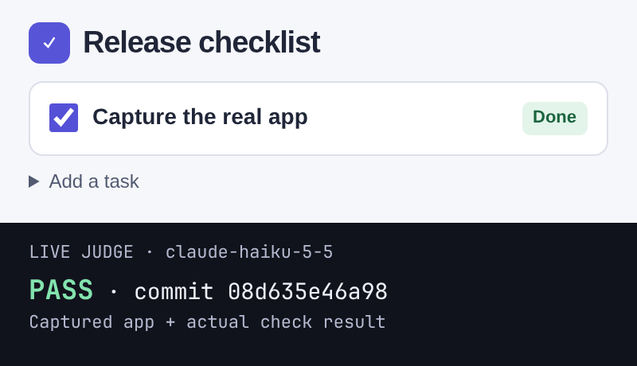

<a id="done-done"></a>
<div align="center">


[](https://www.npmjs.com/package/done-done-axi) [](https://nodejs.org) [](#whats-next)

</div>

# Prove your app really works.

A command-line check of real screenshots, recordings and output.

For developers using coding agents, alone or in a [Firstmate](#use-with-firstmate-or-another-agent-fleet) fleet. Tests can pass while the app is still broken.



<sub>Real sample app + live judge verdict, at the captured commit.</sub>

```sh
npm install -g done-done-axi
cd your-app && done-done init
done-done verify --outcome "<what works now>"
```

The last line is your first result: your agent drives the real app, a judge checks each capture, and you get a pass with a receipt, or the judge's reason it did not pass.

**With or without Firstmate.** On its own, you or your agent run these three lines. In a [Firstmate](https://github.com/kunchenguid/firstmate) fleet, two files make every worker prove its task, plus an optional merge gate that checks that proof ([how](#use-with-firstmate-or-another-agent-fleet)).

[Website](https://umeranjum17.github.io/done-done-axi/) · [Setup](#install-in-3-steps) · [Agent skill](#use-it-from-your-agent) · [Reference](docs/reference.md) · [npm](https://www.npmjs.com/package/done-done-axi)

## Install in 3 steps

You need **[Node 22.18+](https://nodejs.org) and git**, plus your own signed-in coding agent or API key for the judge. Early preview; see [what's next](#whats-next).

1. **Install.** The first line above puts `done-done` (and the long name `done-done-axi`) on your PATH. No `sudo`? Add `--prefix ~/.local` and put `~/.local/bin` on your `PATH`.
2. **Set up your repo.** `init` asks you, in a terminal, which coding agent drives your app and which judge checks it. done-done never picks either for you. It then writes a minimal `.done-done.yaml` and a verify skill: how to launch and drive your app. Outside a terminal, pass `--agent <agent> --model <model> --judge <agent> --judge-model <model>` instead.
3. **Get your first result.** Say what works now, in plain words. `verify` has your agent drive the real product the way a user does and save screenshots or output. A fresh judge checks whether each capture shows your claim. A pass names the capture and writes a receipt for this commit. Anything else stops at a gate with the judge's reason, and `done-done respond` answers it. No judge pass, no receipt.

Optional setup check: `done-done doctor --probe` requires a real answer from your chosen agent; it checks setup, not whether your app works.

For a signed-in Claude Code setup, pass `--agent claude --model claude-haiku-5-5 --judge claude --judge-model claude-haiku-5-5` to `init`. For Codex, use `--agent codex --model gpt-6.1-sol` with that same judge. Codex readers and probes require a CLI with `exec --ignore-user-config` and `debug models --bundled`: they keep your login, but disable MCP, project instructions and model-provided tools; edit/drive steps keep your normal Codex config. Codex is not a judge route.

Claude Code and Codex are proven live. **OpenCode is not yet proven live:** its free tier rejects done-done's tools-off calls with HTTP 403 (`opencode/deepseek-v4.1-flash-free`), so `init`, `doctor --probe` and a judged run are not proven there, and `opencode/muse-spark-1.3-contributor-free` may be absent from the installed catalog. To try OpenCode, choose a model your plan already covers from `opencode models` with `--agent opencode --model <provider/model>`; done-done never needs a new account or API spend.

No result? `done-done doctor` changes nothing and names each missing piece, such as a verify skill `init` could not write, with the exact command that fixes it. Commit `.done-done.yaml` and the verify skill so later runs and your teammates use the same recipe. You choose the agents and models; captures go to your chosen judge's provider, on your own plan or key. [Manual CLI](#manual-cli) walks through recording a journey, checking it and saving a receipt.

## Why

<a id="no-proof-no-done"></a>

**No proof, no "done".** "Done" is easy to say. Screenshots get reused, recordings go stale, and a green test run is not the app.

done-done runs your capture and ties every screenshot, recording and log it saves to the exact commit. When someone says "done", it checks the proof they point to: is it really there, is it a real picture or video, is it from this commit, and is it new? If not, the check fails. If it can't tell, it says so instead of passing.

## See it work

Four moments from a demo notes app. Every picture is real output from the current build; the demo's judge is a stub that says the screen shows the outcome, so no model runs.

<picture><source media="(prefers-color-scheme: dark)" srcset="docs/media/run-dark.svg"></picture>
<picture><source media="(prefers-color-scheme: dark)" srcset="docs/media/pass-dark.svg"></picture>

<picture><source media="(prefers-color-scheme: dark)" srcset="docs/media/reasons-dark.svg"></picture>
<picture><source media="(prefers-color-scheme: dark)" srcset="docs/media/config-dark.svg"></picture>

done-done is an [AXI](https://axi.md), which means -

- It's just a CLI any capable agent can run without setup.
- It's built for agents: [TOON](https://github.com/toon-format/spec) output by default (`--json` and `--full` when needed), and every result names the next command in its `help` lines.
- The skill below only handles discovery; agents learn done-done by using it.

## Use It From Your Agent

You need Node 22.18 or later and git. Give your agent the done-done skill in the [Agent Skills](https://agentskills.io) format with [`npx skills`](https://github.com/vercel-labs/skills), naming your agent with `-a`:

```sh
npx skills add umeranjum17/done-done-axi --skill done-done -a <agent> -y
```

`<agent>` is `claude-code`, `codex`, `opencode`, `pi` or `gemini-cli`. `-a` and `-y` skip the installer's four prompts and keep it from writing skill folders for agents you do not use.

The skill lands in this project (`.claude/skills/done-done/` for Claude Code, `.agents/skills/done-done/` for Codex, opencode, Pi and Gemini CLI) next to a `skills-lock.json`: commit both so your teammates get it too. Or add `-g` to install it once for all your projects (for example `~/.claude/skills/` for Claude Code) and leave the project untouched.

That is the entire setup - no npm install needed.
The skill tells your agent to use `done-done` if it is on PATH and otherwise run the npm package through `npx`, so the CLI comes along on demand:

```sh
npx -y done-done-axi --help
```

The skill is a short stub and sends the agent to `--help` and the bare command for current instructions, so an installed copy cannot go stale against a newer CLI.

Then, in agents that expose skills as slash commands (Claude Code, for example), invoke it directly:

```
/done-done prove the app in this repo works
```

Or just ask in plain words - "prove the app in this repo works", "is this really done?", "gate this PR on proof" - and the agent loads the skill on its own.

## Other Ways to Use done-done

The skill is the recommended path, but it is not the only one.

### Manual CLI

Prefer a terminal to an agent skill? The [manual walkthrough](docs/manual-cli.md) covers installation without sudo, choosing agents, capture recipes, core and upgrade journeys, hooks, `doctor`, checks, receipts and the verify/fix loop. All behavior details live there or in the [reference](docs/reference.md).

## Write journeys in plain words

A journey is the saved script that drives your app and captures what a user sees. You do not have to write it yourself. Describe it, and the agent you chose at `init` writes it:

```sh
done-done journey add "greet Umer and check that Hello Umer is printed"
done-done journey enhance greet-umer-prints-hello "add checks for an empty name and an unknown command"
done-done journey improve greet-umer-prints-hello "also check that greeting Zoë prints exactly Hello Zoë"
```

- **`add "<description>"`** writes a new journey: a capture script in `journeys/`, its entry in `.done-done.yaml` and a feature in your verify skill. It names the journey from your words and prints that name.
- **`enhance <name> ["<focus>"]`** deepens one journey you already have with more steps, edge cases and checks, and keeps the checks it has. Leave out the focus for a general pass.
- **`improve <name> "<instruction>"`** makes one specific change to one journey and nothing else.

Each command prints the files it changed, then runs the journey once. This is the real output of the three lines above, from a clean install on a small greeting CLI with Claude Code as the agent (run paths cut short with `…`):

```
$ done-done journey add "greet Umer and check that Hello Umer is printed"
Added journey greet-umer-prints-hello through claude. Review these repo changes:
.agents/skills/done-done-verify-hello-umer/features/README.md | 1 +
 .done-done.yaml                                               | 3 +++
 2 files changed, 4 insertions(+)
 journeys/greet-umer-prints-hello.mjs | 29 new lines
 .agents/skills/done-done-verify-hello-umer/features/greet-umer-prints-hello.md | 13 new lines
The first run is a dirty-tree trial, not clean proof. Review and commit, then: done-done run greet-umer-prints-hello
ok greet-umer-prints-hello
command: run
result: recorded
dirty: true
files: 1
evidence[1]: …/terminal.txt

$ done-done journey enhance greet-umer-prints-hello "add checks for an empty name and an unknown command"
Enhanced journey greet-umer-prints-hello through claude. Review these repo changes:
.../features/greet-umer-prints-hello.md            |  8 +++++++
 .done-done.yaml                                    |  4 +++-
 journeys/greet-umer-prints-hello.mjs               | 27 +++++++++++++++++++---
 3 files changed, 35 insertions(+), 4 deletions(-)
…
files: 3
evidence[3]: …/terminal-empty-name.txt,…/terminal-unknown-command.txt,…/terminal.txt

$ done-done journey improve greet-umer-prints-hello "also check that greeting Zoë prints exactly Hello Zoë"
Improved journey greet-umer-prints-hello through claude. Review these repo changes:
.../features/greet-umer-prints-hello.md                       |  8 ++++++++
 .done-done.yaml                                               |  1 +
 journeys/greet-umer-prints-hello.mjs                          | 11 ++++++++++-
 3 files changed, 19 insertions(+), 1 deletion(-)
…
files: 4
evidence[4]: …/terminal-empty-name.txt,…/terminal-unknown-command.txt,…/terminal-zoe.txt,…/terminal.txt
```

`.done-done.yaml` keeps what you asked for next to the journey:

```yaml
journeys:
  greet-umer-prints-hello:
    command:
      # Enhanced focus: "add checks for an empty name and an unknown command"
      # Improved instruction: "also check that greeting Zoë prints exactly Hello Zoë"
      node journeys/greet-umer-prints-hello.mjs
```

That first run is a trial on uncommitted files, not proof. Read the generated script as you would any code an agent wrote, commit it, then `done-done run greet-umer-prints-hello` records clean proof (`dirty: false`). The saved script needs no agent or model, so CI can replay it. Generation itself runs only on your machine, never in CI, and uses only the agent you configured. `done-done journey --help` shows these examples; the [reference](docs/reference.md#add-a-journey-from-a-description) has every rule.

## What it checks

- 🧪 **The real product, not code checks**: Proof must come from driving the app, CLI or site the way a user does. A config whose journeys only run tests, typecheck, lint or a build, or proof whose captures all come from such runs, is refused by `check`, `receipt` and `gate`, and `doctor` flags it ([rule](docs/reference.md#real-product-evidence)).
- 🎯 **The core journey and the upgrade users take**: Each app names the one flow a user cannot live without, driven end to end on the real target, and an app that ships an installable artifact also names the upgrade over its previous release. `doctor` and the verify skill `init` writes require both ([rule](docs/reference.md#core-journey-and-release-path)).
- 🧭 **The journeys your change needs**: `done-done affected [<base>]` reads the diff since the last receipt (or the default branch), maps each changed file to the journeys whose command runs it and the verify skill features whose file cites it, adds the core journey when a file is in no feature or journey, and exits 1 until a receipt for HEAD has a run of each. It flags the files no feature covers, so the feature map grows with the code ([how](docs/reference.md#affected-journeys)).
- 🔗 **Tied to a commit**: Every run records the commit, and whether there were uncommitted changes.
- 🖼️ **Real media**: Empty, cut-off, blank or tiny screenshots fail. Videos must hold real frames (needs `ffprobe`).
- ⏱️ **Fresh**: Proof from an older commit fails. Commits that only touch docs can be set to keep it fresh.
- ♻️ **Not reused**: Proof made only of files already used for a different claim fails, and so does citing the same file twice. A claim is named by `--claim-id <id>`, which defaults to your branch, so rewording it keeps its proof. Several claims on one branch each need their own `--claim-id`.
- 🧾 **Honest claims**: Reads a pull request's `## Checks` block — from a file, a URL, or stdin — and makes sure every line is filled in.
- 📌 **Verifiable later**: `receipt` records a passing check against the exact commit and the sha256 of every file it cited; `receipt --verify` re-checks it from any checkout of that commit on the same machine (a merge gate or a fresh clone) ([how](docs/reference.md#where-proof-lives)).
- 👀 **Shows the outcome** (always): `check`, `receipt` and `verify` start done-done's own judge, a fresh, tools-off agent on your own plan or key (Claude Code, opencode, pi or Gemini CLI, or your own OpenAI API key), to say whether each capture is the right screen for the claim (and each text capture, such as a log, JSON or CLI output, the right output), and a wrong one fails. There is no way to turn it off: done-done gives no result without it. The checks above never pass on their own, and a check that cites only files the judge cannot read (a video) stops before the judge, with exit 2. You choose the judge route (`done-done init --judge <agent> --judge-model <model>`, or pick it from the list done-done shows in a terminal; `done-done check --judge <route>` overrides it for one call); for a Pi judge with no explicit model, done-done defaults to `openai-codex/gpt-6-luna` unless `agent_config.pi.model` is set. Any agent and model you choose runs, your coding agent's own too. A judge that fails or times out stops the command with its cause (exit 2; a `verify` run stops with exit 2 and its cause in the run record), and no receipt is written.
- 🎨 **Looks right**: `done-done design <screens...> [--mock <screen>=<mock>]` has the same judge look at each captured screen, alone or next to its approved mock, and fails it on stretched or squashed images, clipped or squashed text, overlap, elements off-screen, blank or black strips and broken layout, naming each defect and where it is ([how](docs/reference.md#design-check)).
- 📐 **Fits the screen**: `done-done look <url>` opens a web page in headless Chrome at a 390x844 phone viewport, captures it, and fails the journey that calls it on squashed text, clipped text, elements cut off by an edge or a page wider than the screen, naming each element, with no model ([how](docs/reference.md#look-check)).
- 🧮 **Honest, cheap claim gate**: `done-done lint <PR URL | report file> <evidence folder>` is a no-model gate on a worker's `## Checks` block, on whenever you call it. It prints `PASS` or `FAIL: <reason>` and exits 1 on a fail: the four lines present, proof naming a command or path, a real repro on a fix PR, evidence files that exist, are non-empty, are newer than the evidence folder and differ from each other, at least one never used by another PR (hashes kept in `~/.done-done/lint.hashes`, every run logged to `lint.log` there), under 1,000 added non-generated lines, and a `WARN` when a PR changes `src/` with no `journeys/` file ([how](docs/reference.md#lint-check)). `evidence: not proven: <cause>` passes.
- 🚦 **CI gate, no model**: `done-done gate [<head>]` passes when a receipt committed under `.done-done-receipts/` covers the head and its captures come from real-product runs, with no judge, config, key or evidence files. CI never runs `check`, `run` or `verify` and never gets a model key; proof runs on your desktop ([how](docs/reference.md#ci-gate)).
- 🧩 **Page is clean** (with a `dom` block): each captured screen also needs its page-check record. A page that overflows the viewport, logs a console error, has a failed request or shows squashed, clipped or cut-off UI fails, unless an allow list names it ([how](docs/reference.md#dom-assertions)).

Every answer is an exit code: **0** pass, **1** fail, **2** usage or config error (including no agent or judge set, a check that fails before its judge, a capture the judge cannot be sent, or a judge that did not answer: never a result), **3** can't tell either way, **4** a `verify`, `maintain` or `rerun` run is still running, or a `verify` run waits at its gate.

## Alone, and with the other tools

done-done works on its own: the CLI and the skill need nothing else. It is one of three tools that each do one job and connect through small written contracts ([Vision](VISION.md)):

- [`sign-off-axi`](https://www.npmjs.com/package/sign-off-axi): the board where agents ask you questions. `done-done signoff` writes a run's gate (when the judge was unsure) or its evidence in sign-off's message format and prints the post command; it never posts on its own. With the opt-in (`done-done signoff --post`, or `signoff.post: true` in `.done-done.yaml`) it posts that message to the board through sign-off-axi, records the card on the run, and `done-done signoff --wait` brings the answer back to the same run. Without sign-off you answer at the terminal with `done-done respond`.
- [`learn-from-mistakes-axi`](https://www.npmjs.com/package/learn-from-mistakes-axi): the retro tool that finds mistakes your agents keep repeating, with evidence. Neither tool needs the other.
- [`first-draft-axi`](https://www.npmjs.com/package/first-draft-axi): turns a prompt into design mocks. Pass a mock to `done-done design <screen> --mock <screen>=<mock>` to judge a captured screen next to it.

## Use with Firstmate or another agent fleet

done-done works the same with or without Firstmate: nothing below is needed to use it, and the skill and CLI behave identically inside or outside a Firstmate home.


[Firstmate](https://github.com/kunchenguid/firstmate) hands tasks to agent workers and merges their work. done-done ships what those workers need to prove each task, and what the merge needs to check that proof, in [`integrations/firstmate/`](integrations/firstmate/).

Install the skill once per machine for your workers' agent (the same `-a` values), install the CLI from npm, and copy two files from it into your Firstmate home:

```sh
npx skills add umeranjum17/done-done-axi --skill done-done -g -a <agent> -y
npm install -g done-done-axi
cat "$(npm root -g)/done-done-axi/integrations/firstmate/brief-include.md" >> "$FM_HOME/config/brief-include.md"
cp "$(npm root -g)/done-done-axi/integrations/firstmate/merge-gate" "$FM_HOME/config/merge-gate"
```

- **`brief-include.md`**: Firstmate adds `config/brief-include.md` to every worker brief. It tells the worker to set up done-done, run the journeys `done-done affected` lists for its committed change, write a `## Checks` block, pass `check`, record a `receipt`, and see `affected` exit 0. The evidence and receipt stay in `~/.done-done/evidence/<app>` after teardown deletes the worktree.
- **`merge-gate`** (optional): `merge-gate <task-id> <worktree|-> <head> <pr-url|->`. In the worktree, it refuses a PR whose head is not `<head>`, then runs `done-done check --from <PR URL or $FM_HOME/data/<task-id>/checks.md> --trusted-ref <default branch>` (`origin/HEAD`, else `origin/main` or `origin/master`, else the local `main` or `master` in a repo with no remote), then `done-done receipt --verify <head>`. Both paths read done-done's rules from your default branch, never from the task's own branch, so merge `.done-done.yaml` there before you rely on it. The gate does not fetch: it reads the local `origin` refs, so run `git fetch origin` before you run it. It needs `done-done` on PATH (the `npm install` line above). A nonzero exit refuses the merge, and done-done's output says why. A worktree of `-` means the task recorded none, so there is no repo to check: the gate refuses (exit 2) rather than check whatever folder it was called from. Its `check` always starts the judge the user set, which must pass each capture; with none set, the gate refuses (exit 2). Upstream Firstmate does not call a merge gate yet, so this file has no effect until it does; you can run it by hand before a merge.

Another fleet works the same way: add the include text to whatever your workers read first, and run `merge-gate` before each merge, with `FM_HOME` set to the folder that holds `data/<task-id>/checks.md` for local-only tasks.

## Learn more

- [Vision](VISION.md): who done-done is for, the problem, where it is going, what it is not, and the next milestones.
- [Worked example: a CLI project](docs/example-cli.md): set up, one journey, check and receipt on a command-line tool.
- [Worked example: create and maintain a verify skill](docs/example-create-maintain.md): init writes the skill, a source change makes it drift, maintain fixes it, then a real browser journey is judged.
- [Full reference](docs/reference.md): every command and option, the Checks block rules, each file check, and both config files.
- [Report a problem or ask a question](https://github.com/umeranjum17/done-done-axi/issues)

## What's next

So far: `init`, `doctor`, `run` (including `--open` and `--close`), `check`, `receipt`, `affected` (the journeys a diff needs), `lint` (a no-model gate on a Checks block), `gate` (a no-model CI check of a committed receipt), `verify` (by journey or by your coding agent, with a gate you answer with `respond`), `journey add`, `enhance` and `improve` (journeys from plain words), `maintain`, the capture judge (always on), the `design` visual check, the `look` step, the run tools (`status`, `attach`, `logs`, `rerun`, `abort`, `signoff`, `history`) and the opt-in session hooks for Claude Code, Codex, opencode, Gemini CLI and pi. Coming next: the [milestones in the vision](VISION.md#next-milestones).

## Develop

```sh
git clone https://github.com/umeranjum17/done-done-axi
cd done-done-axi
npm install
npm install -g --prefix ~/.local .   # optional: links this checkout as done-done on your PATH
npm test   # builds, then runs the end-to-end tests against throwaway git repos
npm run build:skill              # regenerate skills/done-done/SKILL.md from src/skill.ts
npm run build:skill -- --check   # fail if the committed skill is out of date
```

To try an unreleased commit without cloning, run it straight from GitHub (npm 12 needs `--allow-git=all`):

```sh
npx -y --allow-git=all github:umeranjum17/done-done-axi --help
```

`dist/` is committed, so installing from GitHub needs no build step. `npm test` rebuilds it and fails while the rebuilt `dist/` differs from the commit or has files git does not track, so `git add` the new `dist/` files with your change.

The first-screen PNG pairs an actual sample-app screenshot with its real configured-judge pass and captured commit. Start a fresh sample with `node docs/media/demo.mjs <fresh-scratch-directory> 0` (the server prints its owned port), open a native run in its `app/` repo, drive the checklist in the browser, save `app.png` at 400×140 DPR 2 into the run's evidence folder, seal it and run `check` with your configured judge. Save the open result as `<scratch>/open.json` and the check result as `<scratch>/check.json`; `/proof` displays that screenshot and verdict. Capture `/proof` at 400×230 DPR 2 with `chrome-devtools-axi`. It refuses to show a pass without a real passing result. Keep scratch outside the repo and stop the server afterwards. The lower terminal illustrations (hero, run, pass, reasons, config) use a stub judge (no model); redraw them with `npx tsc && node docs/media/make.mjs`. The logo (`docs/logo.svg`) and the flow picture are hand-made SVGs.

The landing page ([`docs/index.html`](docs/index.html), served by GitHub Pages from `main` `/docs`) is static: change it in the same PR as any README change it repeats (install steps, what it checks, the other tools).
