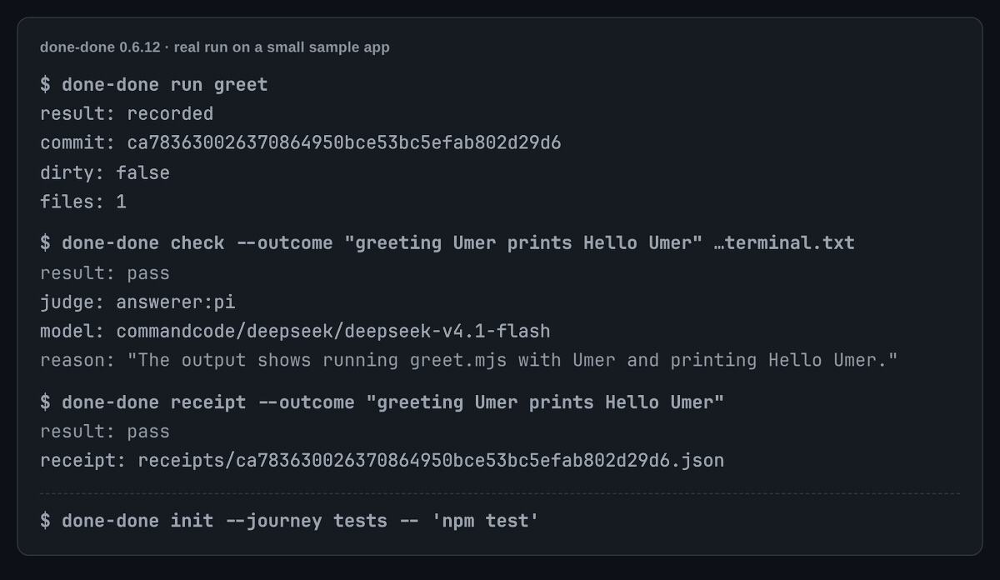

<a id="done-done"></a>
<div align="center">


<h1>Prove your app really works.</h1>

A command-line check that drives your app the way a user does, then has a separate agent judge what it captured.

For developers using coding agents: the tests pass, the agent says "done", and the app is still broken.

<picture>
  <source media="(max-width: 600px) and (prefers-color-scheme: dark)" srcset="docs/media/hero-phone-dark.png">
  <source media="(max-width: 600px)" srcset="docs/media/hero-phone-light.png">
  
</picture>

<sub>A real 0.6.12 run on a small sample app: a capture, the judge's pass and its reason, the receipt, and a test-only journey refused. Long paths shortened; [still, light](docs/media/hero-light.png) · [dark](docs/media/hero-dark.png).</sub>

```sh
npm install -g done-done-axi
cd your-app && done-done init
done-done verify --outcome "<what works now>"
```

The last line is your first result: your agent drives the real app, a fresh judge checks each capture, and you get a pass with a receipt, or the judge's reason it did not pass.

**With or without Firstmate.** Alone, you or your agent run these three lines; nothing else is needed. Inside a [Firstmate](https://github.com/kunchenguid/firstmate) fleet, two small files make every worker prove its task and let the merge check that proof ([how](#inside-firstmate-or-another-agent-fleet)).

[Website](https://umeranjum17.github.io/done-done-axi/) · [Quick start](#quick-start) · [Why](#why-not-just-green-tests) · [Reference](docs/reference.md) · [npm](https://www.npmjs.com/package/done-done-axi)

[](https://www.npmjs.com/package/done-done-axi) [](https://nodejs.org) [](#whats-next)

</div>

## Quick start

You need **[Node 22.18+](https://nodejs.org) and git**, plus your own signed-in coding agent or API key for the judge.

1. **Install.** The first line above puts `done-done` and `done-done-axi` on your PATH. No `sudo`? Add `--prefix ~/.local` and put `~/.local/bin` on your `PATH`.
2. **Set up your repo.** `init` asks which coding agent drives your app and which judge checks it, and never picks either for you. It writes a minimal `.done-done.yaml` and a verify skill that says how to launch and drive your app. Outside a terminal, pass `--agent <agent> --model <model> --judge <agent> --judge-model <model>`.
3. **Get your first result.** Say what works now, in plain words. Your agent drives the real product as a user would and saves screenshots, a recording or output; a fresh judge checks whether each capture shows your claim. A pass names the capture and writes a receipt for this commit; anything else stops at a gate with the judge's reason, which `done-done respond` answers.

Commit `.done-done.yaml` and the verify skill so later runs and your teammates use the same recipe. Captures go to your judge's provider, on your plan or key.

## Why: not just green tests

| | Green tests, or an agent's word | done-done |
| --- | --- | --- |
| What is checked | Code paths, types, lint, builds | The app, CLI or site, driven the way a user drives it |
| Who looks | You, or nobody | A fresh judge agent you chose, tools off, on your plan |
| Tied to a commit | No | A receipt names the commit and the sha256 of every capture |
| Stale or reused proof | Passes | Fails: proof from an older commit, or a file used for another claim, is refused |
| When it goes wrong | "Done" was wrong, later | The judge's reason, a gate to answer, and no receipt |

## What it checks

- 🧪 **The real product, not code checks.** A journey that only runs tests, typecheck, lint or a build is refused, and so is proof whose captures all come from such a run ([rule](docs/reference.md#real-product-evidence)).
- 🔗 **Tied to a commit, fresh, not reused.** Every run records the commit and whether the tree was dirty; older-commit proof fails, and a file used for another claim is reuse ([how](docs/reference.md#where-proof-lives)).
- 👀 **A judge always answers.** A fresh, tools-off judge on your plan looks at every `check`, `receipt` and `verify`. It cannot be turned off, and a judge that fails to answer stops the command instead of passing ([how](docs/reference.md#judge-relevance)).
- 🧾 **Honest claims, no model.** `done-done lint <PR URL | file> <evidence folder>` gates a worker's `## Checks` block: four filled lines, and evidence that exists, differs, is newer than the folder and was never used by another PR ([how](docs/reference.md#lint-check)).
- 🚦 **CI gate, no key.** `done-done gate` passes when a committed receipt covers the head; CI never runs `check`, `run` or `verify` and never gets a model key ([how](docs/reference.md#ci-gate)).
- 🎨 **Looks right, fits the screen.** `done-done design` has the judge compare a screen with its approved mock; `done-done look <url>` fails a 390 px page that overflows, with no model ([design](docs/reference.md#design-check), [look](docs/reference.md#look-check)).

Every answer is an exit code: **0** pass, **1** fail, **2** usage or config error, **3** can't tell either way, **4** a run is still going or waits at its gate ([all codes](docs/reference.md#exit-codes)).

## See it work

Four more moments from a demo notes app: a capture for the current commit, a judged pass, a check that refuses an older commit and two bad files, and a config error that stops the run. Real output from the current build; these four use a stub judge that says the screen shows the outcome, so no model runs.

<p align="center"><picture><source media="(prefers-color-scheme: dark)" srcset="docs/media/run-dark.svg"></picture></p>

<p align="center"><picture><source media="(prefers-color-scheme: dark)" srcset="docs/media/pass-dark.svg"></picture></p>

<p align="center"><picture><source media="(prefers-color-scheme: dark)" srcset="docs/media/reasons-dark.svg"></picture></p>

<p align="center"><picture><source media="(prefers-color-scheme: dark)" srcset="docs/media/config-dark.svg"></picture></p>

The hero above is a real run of the published CLI on a fresh sample repo, replayed line by line: `run` recorded the capture at commit `ca78363`, the Pi judge on `commandcode/deepseek/deepseek-v4.1-flash` read it and passed it with that reason, `receipt` wrote the receipt, and `init` refused a journey whose only command was `npm test`. [The manual walkthrough](docs/manual-cli.md) does the same by hand.

## Use it from your agent

Give your agent the done-done skill in the [Agent Skills](https://agentskills.io) format, naming your agent with `-a`:

```sh
npx skills add umeranjum17/done-done-axi --skill done-done -a <agent> -y
```

`<agent>` is `claude-code`, `codex`, `opencode`, `pi` or `gemini-cli`. The skill lands in this project (`.claude/skills/done-done/` for Claude Code, `.agents/skills/done-done/` for the rest) next to a `skills-lock.json`: commit both so your teammates get it, or add `-g` to install it once for all projects. No npm install is needed: the skill runs `done-done` from your PATH, else the npm package through `npx`. Then ask in plain words ("prove the app in this repo works") or use your agent's slash command.

## Journeys in plain words

A journey is the saved script that drives your app and captures what a user sees. Describe it and your agent writes it:

```sh
done-done journey add "greet Umer and check that Hello Umer is printed"
done-done journey enhance greet-umer-prints-hello \
  "add checks for an empty name and an unknown command"
done-done journey improve greet-umer-prints-hello \
  "also check that greeting Zoë prints exactly Hello Zoë"
```

`add` writes the script, its config entry and its feature in the verify skill; `enhance` deepens one journey; `improve` makes one change to one journey. Each exercise runs once on uncommitted files, which is a trial, not proof: read the script, commit it, then `done-done run <name>`. The saved script needs no agent or model, so CI can replay it; generation runs only on your machine ([worked transcript](docs/manual-cli.md)).

## Inside Firstmate, or another agent fleet

done-done works the same with or without Firstmate: the skill and CLI behave identically inside or outside a Firstmate home. [Firstmate](https://github.com/kunchenguid/firstmate) hands tasks to agent workers and merges their work, and [`integrations/firstmate/`](integrations/firstmate/) ships the two files those workers need:

```sh
npx skills add umeranjum17/done-done-axi --skill done-done -g -a <agent> -y
npm install -g done-done-axi
DD="$(npm root -g)/done-done-axi/integrations/firstmate"
cat "$DD/brief-include.md" >> "$FM_HOME/config/brief-include.md"
cp "$DD/merge-gate" "$FM_HOME/config/merge-gate"
```

- **`brief-include.md`**: Firstmate adds `config/brief-include.md` to every worker brief. It tells the worker to set up done-done, run the journeys `done-done affected` lists for its committed change, write a `## Checks` block, pass `check`, record a `receipt`, and see `affected` exit 0.
- **`merge-gate`** (optional): refuses a PR whose head is not the one asked for, then runs `done-done check --from <PR URL>` and `done-done receipt --verify <head>` against your default branch's rules. Upstream Firstmate does not call a merge gate yet, so run it by hand until it does ([details](docs/reference.md#merge-gate-on-the-desktop)).
- **Model pool**: point `judge.pool_command` and `judge.pool_config` at the fleet's `account-pool/bin/fm-model-pool` and done-done picks the Claude account, moves on a rate or usage limit, and falls over to DeepSeek Goat or Cursor auto ([details](docs/reference.md#config)).

Another fleet works the same way: add the include text to whatever your workers read first, and run `merge-gate` before each merge, with `FM_HOME` set to the folder that holds `data/<task-id>/checks.md` for local-only tasks. Evidence and receipts stay in `~/.done-done/evidence/<app>` after teardown.

## The other two tools

done-done works on its own: the CLI and the skill need nothing else. It is one of three tools that each do one job and connect through small written contracts ([Vision](VISION.md)): [sign-off-axi](https://www.npmjs.com/package/sign-off-axi) is the board where agents ask you questions (`done-done signoff` prepares a run's card, `--wait` brings the answer back, and the opt-in posts it); [learn-from-mistakes-axi](https://www.npmjs.com/package/learn-from-mistakes-axi) finds the mistakes your agents keep repeating; [first-draft-axi](https://www.npmjs.com/package/first-draft-axi) turns a prompt into design mocks you can judge a capture against.

## Known limits

- **Claude Code and Codex are proven live. OpenCode is not yet proven live** on our test machine ([why, and what to try](docs/reference.md#agent-and-judge-support-today)).
- Codex readers and probes need a CLI with `exec --ignore-user-config` and `debug models --bundled`. Codex is not a judge route; a Pi judge on `openai-codex/gpt-6.1-sol` judges through your existing Codex login.
- done-done keeps no login of its own: every agent and judge call runs your installed, signed-in CLI on your plan or key.
- Early preview: behaviour and config keys can change between minor versions.

## Manual CLI

Prefer a terminal to an agent skill? The [manual walkthrough](docs/manual-cli.md) covers installation without sudo, choosing agents, capture recipes, core and upgrade journeys, hooks, `doctor`, checks, receipts and the verify/fix loop. Every behaviour detail is there or in the [full reference](docs/reference.md).

## Learn more

- [Vision](VISION.md): who done-done is for, the problem, where it is going, what it is not, and the next milestones.
- [Worked example: a CLI project](docs/example-cli.md) and [create and maintain a verify skill](docs/example-create-maintain.md).
- [Full reference](docs/reference.md): every command and option, the Checks block rules, each file check, and both config files.
- [Config reference](docs/reference.md#config): pooled Claude accounts for judge and agent calls, and the Codex fallback route.
- [Report a problem or ask a question](https://github.com/umeranjum17/done-done-axi/issues)

## What's next

Early preview: behaviour and config keys can change between minor versions. Shipped so far: `init`, `doctor`, `run`, `check`, `receipt`, `verify`, `journey add|enhance|improve`, `maintain`, `affected`, `lint`, `gate`, `design`, `look`, and the run tools (`status`, `attach`, `logs`, `rerun`, `abort`, `signoff`, `history`). Next: the [milestones in the vision](VISION.md#next-milestones).

## Develop

```sh
git clone https://github.com/umeranjum17/done-done-axi
cd done-done-axi
npm install
npm test
```

`npm test` builds, then runs the end-to-end tests against throwaway git repos. `dist/` is committed, so installing from GitHub needs no build step; `npm test` fails while the rebuilt `dist/` differs from the commit, so `git add` the new files with your change. [Working on done-done](docs/reference.md#working-on-done-done) covers the skill build, the sample app and the screenshots.

The landing page ([`docs/index.html`](docs/index.html), served by GitHub Pages from `main` `/docs`) is static: change it in the same PR as any README change it repeats (install steps, what it checks, the other tools).
