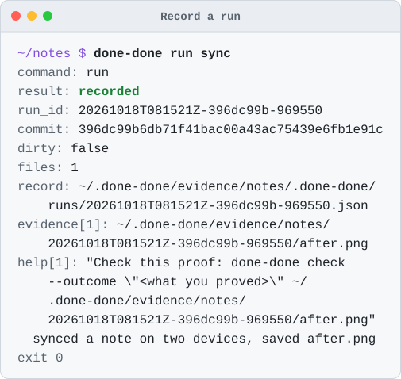
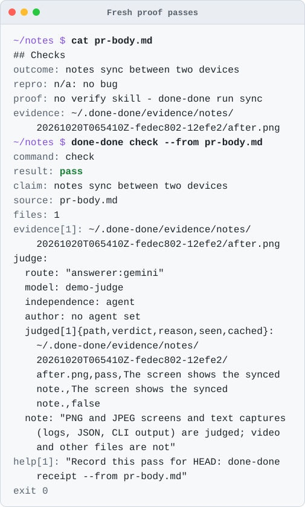
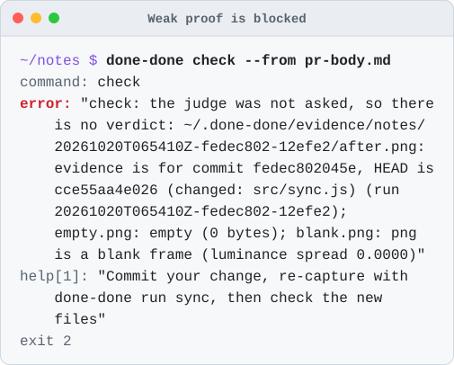

<div align="center">

<picture>
  <source media="(prefers-color-scheme: dark)" srcset="docs/media/wordmark-dark.svg">
  
</picture>

### No proof, no "done".

done-done won't accept "done" without real, fresh proof from your product, captured at the exact commit being called done.

[](https://nodejs.org) [](#whats-next) [](https://www.npmjs.com/package/done-done-axi)

<br>

<picture>
  <source media="(prefers-color-scheme: dark)" srcset="docs/media/flow-dark.svg">
  
</picture>

<br><br>

<picture>
  <source media="(prefers-color-scheme: dark)" srcset="docs/media/hero-dark.svg">
  
</picture>

</div>

## Why

"Done" is easy to say. Screenshots get reused, recordings go stale, and a green test run is not the app.

done-done runs your capture and ties every screenshot, recording and log it saves to the exact commit. When someone says "done", it checks the proof they point to: is it really there, is it a real picture or video, is it from this commit, and is it new? If not, the check fails. If it can't tell, it says so instead of passing.

## See it work

Four moments from a demo notes app. Every picture is real output from the current build; the demo's judge is a stub that says the screen shows the outcome, so no model runs.

<picture><source media="(prefers-color-scheme: dark)" srcset="docs/media/run-dark.svg"></picture>
<picture><source media="(prefers-color-scheme: dark)" srcset="docs/media/pass-dark.svg"></picture>

<picture><source media="(prefers-color-scheme: dark)" srcset="docs/media/reasons-dark.svg"></picture>
<picture><source media="(prefers-color-scheme: dark)" srcset="docs/media/config-dark.svg"></picture>

done-done is an [AXI](https://axi.md), which means -

- It's just a CLI any capable agent can run without setup.
- It's built for agents: [TOON](https://github.com/toon-format/spec) output by default (`--json` and `--full` when needed), and every result names the next command in its `help` lines.
- The skill below only handles discovery; agents learn done-done by using it.

## Use It From Your Agent

You need Node 22.18 or later and git. Give your agent the done-done skill in the [Agent Skills](https://agentskills.io) format with [`npx skills`](https://github.com/vercel-labs/skills), naming your agent with `-a`:

```sh
npx skills add umeranjum17/done-done-axi --skill done-done -a <agent> -y
```

`<agent>` is `claude-code`, `codex`, `opencode`, `pi` or `gemini-cli`. `-a` and `-y` skip the installer's four prompts and keep it from writing skill folders for agents you do not use.

The skill lands in this project (`.claude/skills/done-done/` for Claude Code, `.agents/skills/done-done/` for Codex, opencode, Pi and Gemini CLI) next to a `skills-lock.json`: commit both so teammates and CI get it too. Or add `-g` to install it once for all your projects (for example `~/.claude/skills/` for Claude Code) and leave the project untouched.

That is the entire setup - no npm install needed.
The skill tells your agent to use `done-done` if it is on PATH and otherwise run the npm package through `npx`, so the CLI comes along on demand:

```sh
npx -y done-done-axi --help
```

The skill stays a short stub and sends the agent to `--help` and the bare command for current instructions, so an installed copy cannot go stale against a newer CLI.

Then, in agents that expose skills as slash commands (Claude Code, for example), invoke it directly:

```
/done-done prove the app in this repo works
```

Or just ask in plain words - "prove the app in this repo works", "is this really done?", "gate this PR on proof" - and the agent loads the skill on its own.

## Other Ways to Use done-done

The skill is the recommended path, but it is not the only one.

### Manual CLI

**1. Install**

```sh
npm install -g --prefix ~/.local done-done-axi
```

`--prefix ~/.local` installs into your home folder, so it needs no `sudo`. This installs two names for the same CLI: `done-done-axi` and the short `done-done` used below. If `command -v done-done` prints nothing, add `~/.local/bin` to your `PATH`: `export PATH="$HOME/.local/bin:$PATH"`.

To skip the install, run `npx -y done-done-axi` wherever this README says `done-done`.

**2. Set it up in your app's repo**

```sh
cd your-app
done-done init
```

`init` writes a minimal `.done-done.yaml` (only if you don't already have one) that names your app, and a commented global `~/.done-done/config.yaml` (only if there is none). done-done never picks the coding agent it starts: `init` asks you in a terminal, or takes `--agent <agent> --model <model>`. It never picks the judge either, the agent of its own that `check`, `receipt`, `verify` and `design` always start to look at each capture: `init` asks in a terminal, or takes `--judge <agent> --judge-model <model>`. Any agent and model you choose runs, your coding agent's own too (the judge is a fresh session of its own). The config keys are in the [reference](docs/reference.md#config). A plain `init` never overwrites an existing config. It writes no verify skill: write `.agents/skills/verify-<app>/SKILL.md` by hand, with a launch that never touches real accounts or your own state. Evidence lives outside the repo, in `~/.done-done/evidence/<app>`, so it outlives the checkout that captured it. For an `answerer:pi` judge with no explicit model, done-done uses `openai-codex/gpt-6-luna`; `judge.model` or `agent_config.pi.model` overrides it. Then describe how to capture proof — swap the command for whatever drives your real app and saves screenshots, recordings or logs:

```yaml
journeys:
  smoke:
    command: npm test > $DONE_DONE_EVIDENCE_ROOT/${RUN_ID}.log
```

The command runs from the repo root with `DONE_DONE_EVIDENCE_ROOT` (a new folder for this run in the evidence root) and `DONE_DONE_RUN_ID` set, and `${RUN_ID}` in it is replaced. A run that writes nothing into its folder fails.

Optional: `done-done init --hook <claude|codex|opencode|gemini|pi>` adds a session hook or plugin to the repo that shows each session the bare `done-done` state. Each agent's file and behavior are in the [reference](docs/reference.md#set-up-a-repo).

Record the recipe in the repo so anyone can re-run the proof, then commit it (and `.claude/settings.json`, `.codex/hooks.json`, `.gemini/settings.json`, `.opencode/plugins/done-done.js` or `.pi/extensions/done-done.js` if you added a hook):

```sh
done-done init --journey smoke -- 'npm test > $DONE_DONE_EVIDENCE_ROOT/${RUN_ID}.log'
git add .done-done.yaml
git commit -m "Add done-done"
```

A `run -- <command>` whose command matches no recorded journey still runs, but its result hints that the recipe is not in the repo. For a proof you drive by hand or by your agent instead of a journey, `done-done run --open` prints a run id and a folder to capture into, and `done-done run --close <run-id>` seals it ([how](docs/reference.md#run-a-journey)).

At any point, `done-done doctor` checks the setup and changes nothing except the `--probe` call record. Each item reports `ok`, `warning` or `missing` with the exact fix command; an agent you have not set yet is `missing`, with the command that saves your choice. `done-done doctor --probe` also asks the agent one question to prove it answers; on a new machine that probe fails until the agent is signed in (for pi, run `pi` and then `/login`). The quick start above never calls the coding agent, so `run` and `check` work before it is signed in; `check` does call the judge, so set one first. The items are listed in the [reference](docs/reference.md#check-the-setup).

`done-done maintain` keeps the verify skill true: it checks the skill's links and feature index, checks that every `file:line` it cites exists, and has your coding agent read the source for each feature, read-only, to report drift. It ends `clean`, `drift` with the findings to fix, or `blocked`. It never runs without that reader: an agent that is not set asks, and one that cannot start or cannot read without tools stops it before the run (exit 2). With `auto_fix: { maintain: <n> }` (as in no-mistakes; 0, the default, reports only), your judge first sorts each drift finding (a skill out of date, or a product that may be wrong, which stops and asks you), then your agent fixes the skill folder only, in a done-done worktree, and maintain runs again, up to n times. A clean end is `changed`: one commit on a `done-done/maintain-<run-id>` branch, your branch untouched ([reference](docs/reference.md#keep-the-verify-skill-true)).

**3. Run it, then check it**

```sh
done-done run smoke
done-done check --outcome "it starts" ~/.done-done/evidence/your-app/*/*.log
```

Each command prints one machine-readable result. By default it is [TOON](https://github.com/toon-format/spec) (the compact AXI convention). `run` shows `result: recorded`: it captured evidence, and says nothing about whether it proves the claim. `check` starts your judge on each capture, and only a check the judge passes shows `result: pass`; with no judge set it asks for one, and a judge that fails stops with the cause (exit 2), never a result. Add `--json` for JSON, or `--full` to list every evidence file or finding instead of the first few. After later runs, use the `run_id` the result prints in place of the first `*`.

When a check passes, save a receipt and re-verify it later:

```sh
done-done receipt --outcome "it starts" ~/.done-done/evidence/your-app/*/*.log
done-done receipt --verify "$(git rev-parse HEAD)"
```

No journey yet? `done-done verify --outcome "<what a user can now do>"` has your coding agent drive one feature of the verify skill the way a user does (`--feature <name>` picks it). Your judge then checks the captures. When it says a capture is wrong or unclear, or a capture it cannot read (a video or other file) is not judged, the run waits at its gate (exit 4) until you answer with `done-done respond --action fix`, which ends it `fail` so you fix the product or the recipe and run again: nothing moves a run past its judge, and no receipt is written without a judge pass. Until then, a new `verify` or `rerun` of the same claim in that checkout is refused, so nothing goes around the gate ([details](docs/reference.md#drive-by-agent)).

With `auto_fix: { verify: <n> }` (0, the default, reports only), a failed verify is fixed with your own agent: your judge first sorts each wrong screen (a product bug to fix, or a question that waits at the gate for you), then your agent fixes the product in a done-done worktree with your ignored files copied in, and verify runs again there, up to n times. A pass ends `changed`, with the fix on a `done-done/verify-<run-id>` branch and your branch untouched ([details](docs/reference.md#fix-the-product)).

While a `verify` or `maintain` run goes, `done-done status` shows its steps and next move, `done-done attach` streams its events, and `done-done logs --step <name>` shows one step's log. `done-done rerun` runs a failed verify run again from the failed step, `done-done abort` stops a live run, `done-done signoff` writes a verify run's sign-off message, and `done-done history` lists past runs.

Run `done-done` with no arguments to see the current config and the next step.

## What it checks

- 🔗 **Tied to a commit**: Every run records the commit, and whether there were uncommitted changes.
- 🖼️ **Real media**: Empty, cut-off, blank or tiny screenshots fail. Videos must hold real frames (needs `ffprobe`).
- ⏱️ **Fresh**: Proof from an older commit fails. Commits that only touch docs can be set to keep it fresh.
- ♻️ **Not reused**: Proof made only of files already used for a different claim fails, and so does citing the same file twice. A claim is named by `--claim-id <id>`, which defaults to your branch, so rewording it keeps its proof. Several claims on one branch each need their own `--claim-id`.
- 🧾 **Honest claims**: Reads a pull request's `## Checks` block — from a file, a URL, or stdin — and makes sure every line is filled in.
- 📌 **Verifiable later**: `receipt` records a passing check against the exact commit and the sha256 of every file it cited; `receipt --verify` re-checks it from any checkout of that commit on the same machine (a merge gate or a fresh clone), or in CI once the evidence folder is copied there ([how](docs/reference.md#where-proof-lives)).
- 👀 **Shows the outcome** (always): `check`, `receipt` and `verify` start done-done's own judge, a fresh, tools-off agent on your own plan or key (Claude Code, opencode, pi or Gemini CLI, or your own OpenAI API key), to say whether each capture is the right screen for the claim (and each text capture, such as a log, JSON or CLI output, the right output), and a wrong one fails. There is no way to turn it off: done-done gives no result without it. The checks above never pass on their own, and a check that cites only files the judge cannot read (a video) stops before the judge, with exit 2. You choose the judge route (`done-done init --judge <agent> --judge-model <model>`, or pick it from the list done-done shows in a terminal; `done-done check --judge <route>` overrides it for one call); for a Pi judge with no explicit model, done-done defaults to `openai-codex/gpt-6-luna` unless `agent_config.pi.model` is set. Any agent and model you choose runs, your coding agent's own too. A judge that fails or times out stops the command with its cause (exit 2; a `verify` run stops with exit 2 and its cause in the run record), and no receipt is written.
- 🎨 **Looks right**: `done-done design <screens...> [--mock <screen>=<mock>]` has the same judge look at each captured screen, alone or next to its approved mock, and fails it on stretched or squashed images, clipped or squashed text, overlap, elements off-screen, blank or black strips and broken layout, naming each defect and where it is ([how](docs/reference.md#design-check)).
- 📐 **Fits the screen**: `done-done look <url>` opens a web page in headless Chrome at a 390x844 phone viewport, captures it, and fails the journey that calls it on squashed text, clipped text, elements cut off by an edge or a page wider than the screen, naming each element, with no model ([how](docs/reference.md#look-check)).
- 🧮 **Honest, cheap claim gate**: `done-done lint <PR URL | report file> <evidence folder>` is a no-model gate on a worker's `## Checks` block, on whenever you call it. It prints `PASS` or `FAIL: <reason>` and exits 1 on a fail: the four lines present, proof naming a command or path, a real repro on a fix PR, evidence files that exist, are non-empty, are newer than the evidence folder and differ from each other, at least one never used by another PR (hashes kept in `~/.done-done/lint.hashes`, every run logged to `lint.log` there), and under 1,000 added non-generated lines ([how](docs/reference.md#lint-check)). `evidence: not proven: <cause>` passes.
- 🧩 **Page is clean** (with a `dom` block): each captured screen also needs its page-check record. A page that overflows the viewport, logs a console error, has a failed request or shows squashed, clipped or cut-off UI fails, unless an allow list names it ([how](docs/reference.md#dom-assertions)).
- 🔒 **Safe in CI**: `--trusted-ref origin/main` reads the rules from your main branch, so a pull request can't loosen them.

Every answer is an exit code: **0** pass, **1** fail, **2** usage or config error (including no agent or judge set, a check that fails before its judge, a capture the judge cannot be sent, or a judge that did not answer: never a result), **3** can't tell either way, **4** a `verify`, `maintain` or `rerun` run is still running, or a `verify` run waits at its gate.

## Use with Firstmate or another agent fleet

[Firstmate](https://github.com/kunchenguid/firstmate) hands tasks to agent workers and merges their work. done-done ships what those workers need to prove each task, and what the merge needs to check that proof, in [`integrations/firstmate/`](integrations/firstmate/).

Install the skill once per machine for your workers' agent (the same `-a` values), install the CLI from npm, and copy two files from it into your Firstmate home:

```sh
npx skills add umeranjum17/done-done-axi --skill done-done -g -a <agent> -y
npm install -g done-done-axi
cat "$(npm root -g)/done-done-axi/integrations/firstmate/brief-include.md" >> "$FM_HOME/config/brief-include.md"
cp "$(npm root -g)/done-done-axi/integrations/firstmate/merge-gate" "$FM_HOME/config/merge-gate"
```

- **`brief-include.md`**: Firstmate adds `config/brief-include.md` to every worker brief. It tells the worker to set up done-done, run a journey on its committed change, write a `## Checks` block, pass `check`, and record a `receipt`. The evidence and receipt stay in `~/.done-done/evidence/<app>` after teardown deletes the worktree.
- **`merge-gate`** (optional): `merge-gate <task-id> <worktree|-> <head> <pr-url|->`. In the worktree, it refuses a PR whose head is not `<head>`, then runs `done-done check --from <PR URL or $FM_HOME/data/<task-id>/checks.md> --trusted-ref <default branch>` (`origin/HEAD`, else `origin/main` or `origin/master`, else the local `main` or `master` in a repo with no remote), then `done-done receipt --verify <head>`. Both paths read done-done's rules from your default branch, never from the task's own branch, so merge `.done-done.yaml` there before you rely on it. The gate does not fetch: it reads the local `origin` refs, so run `git fetch origin` before you run it. It needs `done-done` on PATH (the `npm install` line above). A nonzero exit refuses the merge, and done-done's output says why. A worktree of `-` means the task recorded none, so there is no repo to check: the gate refuses (exit 2) rather than check whatever folder it was called from. Its `check` always starts the judge the user set, which must pass each capture; with none set, the gate refuses (exit 2). Upstream Firstmate does not call a merge gate yet, so this file has no effect until it does; you can run it by hand before a merge.

Another fleet works the same way: add the include text to whatever your workers read first, and run `merge-gate` before each merge, with `FM_HOME` set to the folder that holds `data/<task-id>/checks.md` for local-only tasks.

## Learn more

- [Vision](VISION.md): the three-tool family, the rules they share, and where done-done goes next.
- [Worked example: a CLI project](docs/example-cli.md): set up, one journey, check and receipt on a command-line tool.
- [Full reference](docs/reference.md): every command and option, the Checks block rules, each file check, and both config files.
- [Report a problem or ask a question](https://github.com/umeranjum17/done-done-axi/issues)

## What's next

So far: `init`, `doctor`, `run` (including `--open` and `--close`), `check`, `receipt`, `verify` (by journey or by your coding agent, with a gate you answer with `respond`), `maintain`, the capture judge (always on), the `design` visual check, the `look` step, the run tools (`status`, `attach`, `logs`, `rerun`, `abort`, `signoff`, `history`) and the opt-in session hooks for Claude Code, Codex, opencode, Gemini CLI and pi. Coming next: help writing the proof steps for your app.

## Develop

```sh
git clone https://github.com/umeranjum17/done-done-axi
cd done-done-axi
npm install
npm install -g --prefix ~/.local .   # optional: links this checkout as done-done on your PATH
npm test   # builds, then runs the end-to-end tests against throwaway git repos
npm run build:skill              # regenerate skills/done-done/SKILL.md from src/skill.ts
npm run build:skill -- --check   # fail if the committed skill is out of date (CI runs this)
```

To try an unreleased commit without cloning, run it straight from GitHub (npm 12 needs `--allow-git=all`):

```sh
npx -y --allow-git=all github:umeranjum17/done-done-axi --help
```

`dist/` is committed, so installing from GitHub needs no build step. `npm test` rebuilds it and fails while the rebuilt `dist/` differs from the commit or has files git does not track, so `git add` the new `dist/` files with your change.

The terminal pictures (hero, run, pass, reasons, config) are real output from the current build, with a stub judge (no model); redraw them with `npx tsc && node docs/media/make.mjs`. The wordmark and the flow picture are hand-made SVGs.
