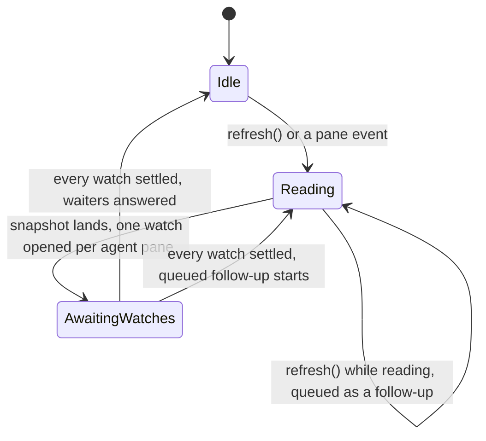
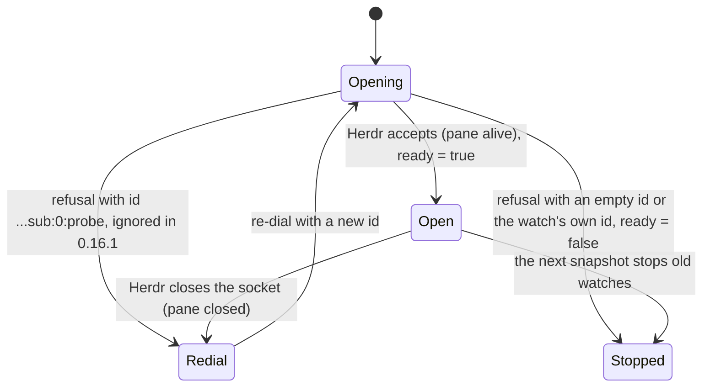

# Pane-attach race: a statechart pilot

A small statechart and an executable model of one real bug: in muxr v0.2.9, a pane that closes before its status watch opens leaves the shared Herdr tree read waiting forever, so opening a pane that is still alive hangs. A pinned model checker finds that path on the old code, and the path is written below as the steps a user takes.

**This is supporting evidence only. It is not proof that muxr works or fails.** Real-product replay: **not checked**. No Herdr lifecycle command was run and muxr was not touched. The journey entry that a real replay would follow is [pane-attach-race.md](pane-attach-race.md). It is written in the format of muxr's project skill and is waiting for an isolated Herdr lab.

Files: [PaneAttach.tla](PaneAttach.tla) (model and properties), [check.mjs](check.mjs) (repeatable check), [pane-attach-race.md](pane-attach-race.md) (project-skill journey entry).

## The code it models

| Model action | Real code (muxr tag `v0.2.9`, `@byokit/herdr` 0.16.1 as published on npm) |
|---|---|
| `Refresh(U)`: the user opens pane B | `open` → `resolvePane` → `refreshSnapshot` → `client.kit.refresh()` (`apps/host/src/agent/infrastructure/herdrSessionSource.ts:2606, 1878-1897, 1578-1583`) |
| `Refresh(c)` joins a running read or starts one | `HerdrKit.refresh()` (`dist/kit.js:694-706`) |
| `StartBoot` / `SnapshotLands` | `runBootstrap` → `bootstrap` sends `session.snapshot`, stops the old status watches and opens one per agent pane (`dist/kit.js:523-530, 363-371, 409-414, 440-447`; `openStatusWatch` `dist/kit.js:496-514`) |
| `CloseA`, then `ClosedEventLands` | a structural event queues a bootstrap, or a follow-up while one runs (`dist/kit.js:582-597, 562-568`); Herdr closing an acked watch's socket re-dials it (`dist/socket.js:115-121`) |
| `HerdrAnswer(p)` | the watch's frame handler. Only an error whose id is `''` or exactly the watch's id counts as a refusal (`dist/socket.js:94-112`). Herdr refuses a watch on a closed pane with id `<id>:sub:0:probe` (the record in muxr PR 1006) |
| `Retry(p)` | `later(open, backoff)` dials a new watch with a new id (`dist/socket.js:88-92, 120-124`) |
| `AcksSettle` | `Promise.allSettled` over the watches' `ready` promises; `runBootstrap` then answers its waiters and starts the queued follow-up (`dist/kit.js:446-447, 531-557`) |

Source identity: muxr `v0.2.9` is commit `3b8321f897f984ee1bf186177bf89ebfd812de2d`, whose `apps/host/package.json` pins `@byokit/herdr` `0.16.1`. The kit tarball `herdr-0.16.1.tgz` has sha256 `407fc6fce982fd61e5f1a77f60b0516c51ef6bf6963998f8ac80330d6bc2f2c9` (gitHead `39be7f88b7b13b7a9f32fbc1a1d74567016198b0`). Its `dist/socket.js` has sha256 `525d439da77312880dc170f9bf8f186bb0a295fb3d7210372ab19eda44700a90` and its `dist/kit.js` has sha256 `e4e6eb848e3043e97f4c95c485390a963879df67feb7f57a3f188828960f8597`.

## Statechart

One tree read in the kit:



One pane's status watch:



The bad loop is `Opening → Redial → Opening`, entered while the tree read waits in `AwaitingWatches`. The watch's `ready` never settles, so the tree read never leaves `AwaitingWatches`. Every `refresh()` waits behind it, and so does every pane open.

## Properties

1. **After a final refusal, its watch settles** (`WatchSettles`): once Herdr refuses a pane's watch, which happens only after the pane has closed for good, that watch eventually stops.
2. **Opening a surviving pane eventually answers** (`AttachAnswers`): once the user opens pane B, the open eventually finishes. This model has no outage or snapshot error, so the only answer is success. Explicit failure paths are outside its scope.

`NeverAttached` is a witness. It is violated exactly when some run opens B, which shows the properties are not passing trivially.

## Results

Run on 22 October 2026 with `node docs/examples/statechart-pilot/check.mjs <tla2tools.jar> <out-dir>`, which exited 0:

| Run | Kit behaviour | Checks | Expected | Got | Distinct states |
|---|---|---|---|---|---|
| `old-watch` | 0.16.1 matcher (`''` or `<id>`) | `WatchSettles` | violated | violated | 460 |
| `old-attach` | 0.16.1 matcher | `AttachAnswers` | violated | violated | 460 |
| `old-witness` | 0.16.1 matcher | `NeverAttached` | violated (B can open) | violated | 97 |
| `fixed` | also matches `<id>:` ids (the kit fix named in PR 1006) | both | hold | hold | 399 |
| `fixed-witness` | corrected matcher | `NeverAttached` | violated (B can open) | violated | 93 |
| `broken-attach` | corrected matcher, but `runBootstrap` never starts the queued follow-up | `AttachAnswers` | violated | violated | 435 |
| `broken-watch` | the same broken variant | `WatchSettles` | holds | holds | 435 |

The broken variant is caught by the attach property, which was not written for it. The watch property still holds for that variant, so the two properties check different things.

### The counterexample, as user steps (`old-attach`)

1. Umer opens agent B on the phone. The host asks the kit to re-read the Herdr tree.
2. Something else re-reads the tree at the same moment, such as another open. It queues behind the first read.
3. The tree comes back listing agents A and B. The kit opens a status watch for each and waits for both.
4. Agent A's pane closes before Herdr has accepted A's watch.
5. Herdr accepts B's watch.
6. Herdr refuses A's watch with id `<id>:sub:0:probe` and closes the socket. The kit does not see that id as a refusal, logs nothing, and dials A's watch again.
7. Each new dial gets the same refusal, forever.

What Umer sees: B stays on "connecting" even though B is alive. Every later open queues behind the same tree read. Only stopping the kit (a host restart) rejects the waiting opens. `old-watch` reaches the same loop one read later: the first tree read lands, and the queued follow-up read is the one that hangs.

## Model report

- Checker: TLC2 Version 2.19 of 08 August 2024 (rev: 5a47802), from [tla2tools.jar v1.7.4](https://github.com/tlaplus/tlaplus/releases/tag/v1.7.4). Its sha256 is `936a262061c914694dfd669a543be24573c45d5aa0ff20a8b96b23d01e050e88` and its sha1 `bee4a54f3ee3d4afc347c3240ec2d9e93b075104` matches the release notes. `check.mjs` refuses any other jar. It ran on OpenJDK 21.0.2 with `-workers 1 -deadlock`: v1.7.4's liveness check is only sound with one worker (tlaplus issue 971), and finished runs are allowed to stop.
- Model `PaneAttach.tla` sha256: `47caab3c3d5eb0fe34841ae841e93cafb51873b67e861fdd1d1e63aee3e7e739`.
- Properties (sha256 of each definition's text): `WatchSettles` `7b79e33aa012dad92414f12b13df535f87fb3ee4facee03b6b07d1695cf373a0`, `AttachAnswers` `40e9a75d27e47f467113ddc84428528769d192a80c73fa112891eb5e8b0da678`, `NeverAttached` `ab58eddaa46974dcbc9273bc1698e06255a1e04c74f44c5f22e501e1b71f122c`.
- Source commit: muxr `3b8321f897f984ee1bf186177bf89ebfd812de2d` (`v0.2.9`) with `@byokit/herdr` 0.16.1 (identity above).
- Bounds: two panes (A may close, B never closes), one other refresh caller and one open of B, each made once. Every open and dial of a watch is modelled, with no retry cap, because the watch loop is finite in state. A full search finds every reachable state; no depth limit is used.
- Assumptions:
  - Herdr answers every request and the kit's timers fire. This is weak fairness on the kit and Herdr steps. The refusal is a delivered answer, not a lost packet, so a network that never answers is not mistaken for this bug.
  - Closing a pane and the user's actions get no fairness; they may never happen.
  - A closed pane never comes back.
  - A snapshot shows the panes alive when it lands. A pane closing between Herdr's read and the reply landing is the same race as closing just after it lands.
  - The `<id>:sub:0:probe` refusal shape comes from the record in muxr PR 1006, not from a Herdr run here.
  - Not modelled: Herdr outages, snapshot errors, the event socket reconnecting, `kit.stop()`, and the 20-second refresh bound and kit restart that PR 1006 adds to the host. Whether that host recovery repairs the property is a separate check and is not claimed here.

## Rerun it

```bash
curl -fLo tla2tools.jar https://github.com/tlaplus/tlaplus/releases/download/v1.7.4/tla2tools.jar
node docs/examples/statechart-pilot/check.mjs tla2tools.jar <out-dir>
```

Each run's TLC transcript, counterexamples included, and `model-report.json` with every hash land in `<out-dir>`. The command exits 1 when any run differs from the expected result above. When the kit or `herdrSessionSource.ts` changes, re-read the cited lines, update the model to match the code, and rerun. If the code no longer matches a row in the code-map table, the model is stale and its results do not apply.
